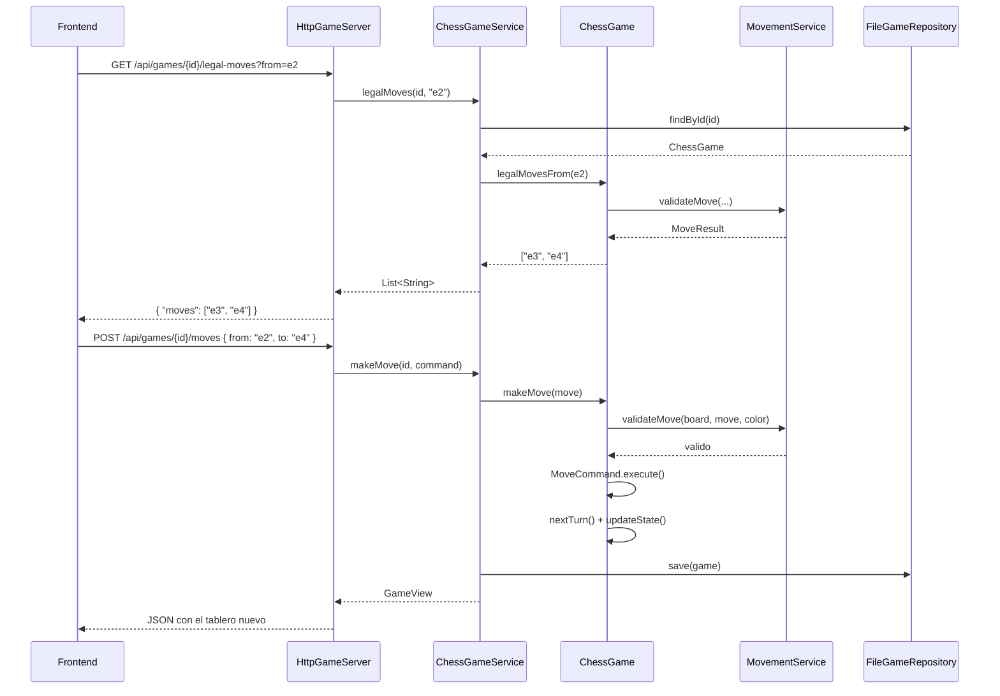
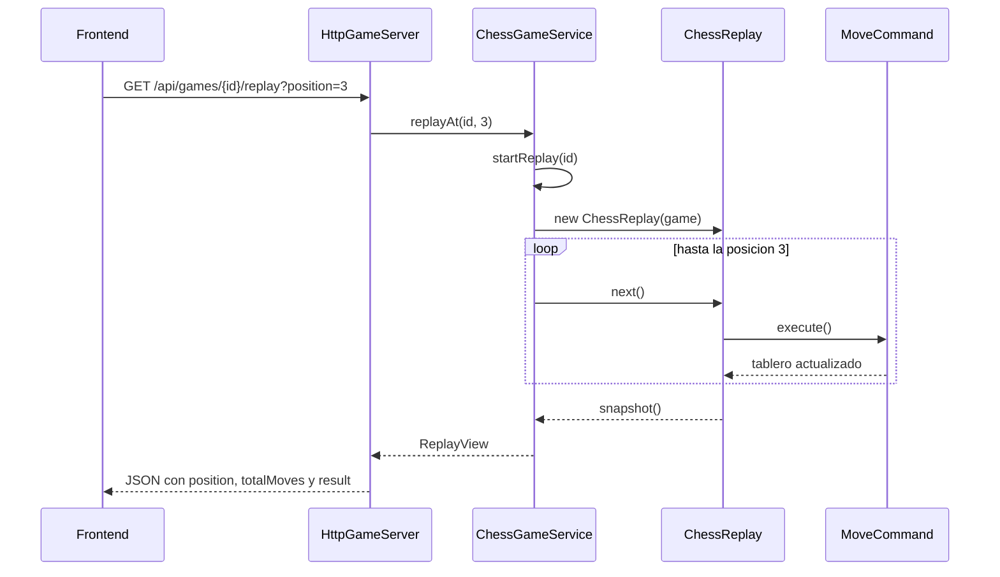

# Arquitectura del ajedrez

Este documento explica cómo está armado el proyecto y por qué. La idea es que
se pueda entender de arriba a abajo sin tener que abrir el código primero.

## 1. La idea general

El proyecto resuelve un ajedrez con dos interfaces sobre el mismo motor: una de
consola y una web. Para eso usamos **arquitectura hexagonal** (puertos y
adaptadores): el dominio no conoce nada de afuera, la aplicación lo conecta con
los casos de uso y la infraestructura implementa los detalles concretos (HTTP,
archivos, consola).

```
domain  <-  application  <-  infrastructure
                              ^
                              |
                         App (composition root)
```

La regla es siempre la misma: **las dependencias apuntan hacia adentro**. El
dominio no importa nada de aplicación ni de infraestructura. La aplicación no
sabe si el jugador está en la terminal o en el navegador. Y la infraestructura
puede cambiar sin tocar las reglas del ajedrez.

## 2. Dominio (`domain`)

El dominio es el corazón del proyecto: tablero, piezas, turnos, reglas, estados
y replay. No hay `System.out`, ni archivos, ni HTTP, ni JSON.

### 2.1. `ChessGame`: el agregado raíz

`ChessGame` representa una partida y guarda lo mínimo necesario para
reconstruirla:

- el `GameId`;
- el `Board`;
- el `Turn` con los dos jugadores;
- el historial de `Move`;
- el `GameState` actual.

Toda jugada pasa por `makeMove`, que hace siempre lo mismo:

1. rechaza la jugada si la partida ya terminó;
2. valida con `MovementService.validateMove`;
3. ejecuta un `MoveCommand` sobre el tablero;
4. agrega la jugada al historial;
5. pasa el turno;
6. recalcula el estado.

`ChessGame` también expone `legalMovesFrom`, que prueba todos los destinos
posibles desde una casilla. La web usa eso para marcar los puntos sin repetir
ninguna regla en TypeScript.

### 2.2. Tablero y piezas

El `Board` es una grilla de 8×8. Cada `Square` puede tener una `Piece` o estar
vacía. Las posiciones se manejan con `Position`, que entiende coordenadas
algebraicas (`e2`, `h8`) y coordenadas internas (fila y columna).

Cada tipo de pieza tiene su propia estrategia de movimiento:

| Pieza | Estrategia |
|-------|------------|
| Peón | `StratPawn` |
| Caballo | `StratKnight` |
| Alfil | `StratBishop` |
| Torre | `StratRook` |
| Reina | `StratQueen` |
| Rey | `StratKing` |

Todas implementan `IMovementStrategy` y devuelven un `MoveResult`. `PieceFactory`
crea las piezas con su estrategia correspondiente y arma el tablero inicial
estándar.

### 2.3. `MovementService`: las reglas compartidas

Las estrategias saben cómo se mueve cada pieza, pero hay reglas que no
pertenecen a una pieza sola. De eso se ocupa `MovementService`:

- no se puede mover una pieza del rival;
- no se puede capturar al rey;
- el camino tiene que estar libre (lo resuelve cada estrategia);
- una jugada no puede dejar al propio rey en jaque;
- detección de jaque, jaque mate y ahogado.

Para probar si una jugada deja al rey expuesto, el servicio copia el tablero,
hace el movimiento sobre la copia y vuelve a buscar jaques. Es una simulación
simple y segura: el tablero real no se toca hasta que la jugada es válida.

### 2.4. Estados de la partida

`GameState` tiene cinco valores:

| Estado | Cuándo aparece |
|--------|----------------|
| `IN_PROGRESS` | La partida sigue normalmente |
| `CHECK` | El jugador de turno está en jaque |
| `CHECKMATE` | Está en jaque y no tiene ninguna jugada legal |
| `ABANDONED` | Un jugador abandonó |
| `DRAW` | Está ahogado: no tiene jugadas legales pero no está en jaque |

`isFinished()` devuelve `true` para `CHECKMATE`, `ABANDONED` y `DRAW`. Esa es la
condición que habilita el replay.

Después de cada jugada, `ChessGame` revisa el estado en este orden: primero
jaque mate, después ahogado, después jaque y, si no pasa nada, `IN_PROGRESS`. El
orden importa porque un jaque mate también es un jaque.

### 2.5. `MoveCommand`: mover y deshacer

`MoveCommand` implementa `ICommand` y guarda qué pieza se movió y qué pieza se
capturó. `execute()` mueve; `undo()` deja el tablero como estaba. No se ocupa
del turno ni del estado de la partida: eso lo maneja `ChessGame`.

Este comando se usa en dos lugares:

- en una partida normal, para aplicar la jugada;
- en el replay, para avanzar y retroceder.

### 2.6. `ChessReplay`: revivir una partida

`ChessReplay` es independiente de la partida guardada. Copia el id, los
jugadores, el resultado y el historial, y después arma un tablero propio desde
la posición inicial estándar.

- `next()` valida la próxima jugada, crea su `MoveCommand` si todavía no existe
  y lo ejecuta.
- `previous()` deshace el último comando ejecutado.
- `snapshot()` devuelve una copia de la partida en la posición actual, para que
  el consumidor no pueda modificar el tablero del replay.

El replay guarda también el estado de cada posición (`CHECK`, `CHECKMATE`,
`DRAW`, etc.) y el resultado original de la partida por separado. Así se puede
mostrar "la posición 3 está en jaque" sin perder que la partida terminó en
jaque mate.

## 3. Aplicación (`application`)

La capa de aplicación orquesta los casos de uso y traduce entre el dominio y el
exterior. No sabe cómo se muestra una partida: solo devuelve objetos de lectura.

### 3.1. Puertos de entrada

Los casos de uso están separados en interfaces chicas:

- `CreateGameUseCase`
- `GetGameUseCase`
- `MakeMoveUseCase`
- `LegalMovesUseCase`
- `AbandonGameUseCase`
- `ReplayGameUseCase`
- `ListGamesUseCase`
- `SaveGameUseCase`

`ChessGameUseCases` las agrupa para que los adaptadores dependan de una sola
interfaz. Si mañana se agrega otro caso de uso, se suma a esta interfaz y listo.

Los diagramas de estas interfaces, de sus implementaciones y de cómo las usa el
frontend están en
[`JUSTIFICACION.md`](docs/JUSTIFICACION.md#3-3-interfaces-y-comunicacion-con-el-frontend).

### 3.2. `ChessGameService`

`ChessGameService` implementa todos los casos de uso y coordina tres cosas:

- el repositorio (`GameRepositoryPort`);
- el servicio de reglas (`MovementService`);
- el logger (`GameLogger`).

El servicio se encarga de buscar la partida, validar entradas, guardar después
de cada cambio y armar la vista de respuesta. No conoce HTTP, ni consola, ni
archivos.

### 3.3. `GameView`: el contrato de lectura

`GameViewMapper` convierte un `ChessGame` en un `GameView`, que es lo que
consumen la consola y la API. Incluye:

- id, estado, turno y número de turno;
- los dos jugadores;
- el tablero de 8×8;
- el historial;
- la última jugada;
- el ganador, cuando hay jaque mate.

Para el listado del lobby existe un `GameSummaryView` más chico, sin tablero:
alcanza con los jugadores, el estado, la cantidad de jugadas y la fecha.

### 3.4. Replay en la aplicación

Hay dos formas de usar el replay:

- `startReplay` devuelve una `ReplaySession`, que es la que usa la consola y
  mantiene el puntero en memoria;
- `replayAt` recibe una posición y devuelve directamente el `ReplayView` de ese
  momento. Es la versión que usa la web, sin sesión guardada en el servidor.

La web pide una posición por request. El backend reconstruye el replay, avanza
hasta la jugada pedida y responde. No hay estado compartido entre requests.

## 4. Infraestructura (`infrastructure`)

La infraestructura implementa los puertos y traduce entre el mundo exterior y
la aplicación.

### 4.1. Adaptador de consola

`ConsoleView` lee comandos de texto, los traduce a llamadas de los casos de uso
y usa `ConsoleRenderer` para dibujar el `GameView`. El loop del juego vive acá,
no en el dominio. También maneja los comandos `legal`, `help`, `quit` y el menú
de replay.

### 4.2. Adaptador HTTP

`HttpGameServer` usa `com.sun.net.httpserver.HttpServer`, que viene en el JDK.
No hay Spring, Maven ni dependencias externas.

El adaptador se encarga de:

- ruteo de `/api/...`;
- CORS para desarrollo;
- lectura del body JSON;
- traducción de excepciones a códigos HTTP;
- escritura de respuestas JSON.

Las clases de apoyo son `GameViewJson` (serialización), `JsonBody` (lectura de
comandos), `Json` (escape y helpers) y `HttpError` (errores del adaptador).

| Método | Ruta | Qué hace |
|--------|------|----------|
| `GET` | `/api/health` | Estado del servidor |
| `GET` | `/api/games` | Lista las partidas guardadas |
| `POST` | `/api/games` | Crea una partida |
| `GET` | `/api/games/{id}` | Devuelve la partida actual |
| `POST` | `/api/games/{id}/moves` | Hace una jugada |
| `GET` | `/api/games/{id}/legal-moves?from=e2` | Destinos legales |
| `POST` | `/api/games/{id}/abandon` | Abandona la partida |
| `POST` | `/api/games/{id}/save` | Vuelve a guardar |
| `GET` | `/api/games/{id}/replay?position=N` | Replay de una partida terminada |

Los errores siguen el formato `{ "error": "CODIGO", "message": "..." }`. Un
body inválido devuelve `400`, una partida inexistente `404`, una jugada ilegal
`409` y una falla inesperada `500`.

### 4.3. Persistencia

`FileGameRepository` guarda cada partida en `games/<id>.properties`.
`GameSerializer` se encarga del formato, que tiene una versión (`formatVersion
= 3`) y estas claves:

| Clave | Contenido |
|-------|-----------|
| `id` | Id de la partida |
| `state` | Estado actual (`IN_PROGRESS`, `CHECKMATE`, `DRAW`, etc.) |
| `turnIndex` | Índice del jugador de turno |
| `turnNumber` | Número de turno |
| `whitePlayer`, `blackPlayer` | Nombres |
| `piece.<fila>,<columna>` | Tipo y color de cada pieza |
| `historySize` | Cantidad de jugadas |
| `history.<i>` | Origen y destino de cada jugada |

Al cargar, el serializador valida la versión y los datos. Si algo está mal,
lanza `GamePersistenceException` y el archivo no se usa.

`InMemoryGameRepository` implementa el mismo puerto para tests y demos. No toca
el disco.

### 4.4. Logging

`GameLogger` es el puerto de salida para logs. `JavaGameLogger` lo implementa
con `java.util.logging` y escribe en consola y `stderr`. El dominio y la
aplicación solo ven la interfaz.

## 5. Composición (`App`)

`App` es el único lugar que conoce las implementaciones concretas. Arma:

1. un `MovementService`;
2. un `FileGameRepository` sobre `games/`;
3. un `ChessGameService` con el repositorio, el servicio y el logger;
4. el adaptador de entrada que corresponda.

Según los argumentos, arranca la consola o el servidor HTTP:

```powershell
java -cp bin com.uade.ajedrez.App
java -cp bin com.uade.ajedrez.App --web
java -cp bin com.uade.ajedrez.App --web --port 9090
```

Agregar otro adaptador de entrada solo requiere implementar los puertos y
elegirlo desde `App`. Las reglas no se tocan.

## 6. Flujo completo de una jugada



El frontend no decide si la jugada es legal. Solo pide los destinos, manda
origen y destino, y reemplaza el tablero con lo que responde el servidor.

## 7. Flujo del replay



El endpoint es sin estado. Cada paso del replay es un request independiente y
el servidor no guarda sesiones. Para las partidas del TP (decenas de jugadas)
reconstruir el historial en cada consulta es barato.

## 8. Frontend (`web/`)

La web está hecha con **Next.js (App Router)**, **TypeScript** y **Tailwind
CSS**. Consume la API y no repite reglas del ajedrez.

| Pantalla | Ruta | Qué hace |
|----------|------|----------|
| Lobby | `/` | Crea partidas y lista las guardadas |
| Partida | `/game/[id]` | Tablero, historial, estado y acciones |
| Replay | `/game/[id]/replay` | Navega una partida terminada |
| Documentación | `/docs` | Muestra estos documentos |

El cliente HTTP está en `lib/api.ts`. El hook `useGame` carga la partida,
refresca cada 2 segundos mientras la pestaña está visible y expone las acciones.
El tablero es solo presentación: pinta el `GameView` y avisa qué casilla se
clickeó.

La pantalla de documentación lee los `.md` del repositorio en el servidor y los
renderiza con `react-markdown`. No hay contenido duplicado: si se edita un
documento, la web muestra la versión nueva al recargar.

## 9. Tests

Los tests son clases con `main` y aserciones de Java, ejecutadas con `-ea`
desde `build.ps1`. No hay JUnit ni un runner externo.

Cubren:

- tablero y movimientos de cada pieza;
- jaque, jaque mate y ahogado;
- comandos y su `undo`;
- casos de uso y persistencia;
- replay con jaque mate, abandono y tablas;
- adaptador HTTP y manejo de errores.

La decisión de no usar JUnit está explicada en
[`JUSTIFICACION.md`](docs/JUSTIFICACION.md). La deuda queda anotada: migrar a
JUnit es un paso natural si el proyecto crece.

## 10. Decisiones y límites

Las decisiones más importantes están desarrolladas en
[`JUSTIFICACION.md`](docs/JUSTIFICACION.md). En resumen:

- arquitectura hexagonal para que las reglas no dependan de la interfaz;
- una estrategia por pieza y un servicio para las reglas compartidas;
- persistencia en archivos `.properties`, sin base de datos;
- API HTTP con el servidor del JDK, sin frameworks;
- polling cada 2 segundos en lugar de websockets;
- replay independiente y sin estado en el servidor;
- tablas por ahogado dentro del dominio.

Lo que todavía no está:

- enroque, promoción y captura al paso;
- tablas por repetición, por 50 movimientos o por material insuficiente;
- autenticación y partidas multiusuario reales;
- deshacer jugadas durante una partida activa.

## 11. Cómo extender el proyecto

- **Agregar una regla nueva**: va en la estrategia de la pieza o en
  `MovementService`, con sus tests. Si cambia el final de la partida, también se
  toca `GameState`.
- **Agregar un adaptador de entrada**: se implementa el puerto que corresponda
  y se elige desde `App`. El dominio no cambia.
- **Cambiar la persistencia**: se implementa `GameRepositoryPort`. Ni las reglas
  ni los casos de uso se enteran.
- **Agregar una pantalla**: consume la API existente. Si falta un dato, se
  agrega al `GameView` y se actualiza el contrato.
