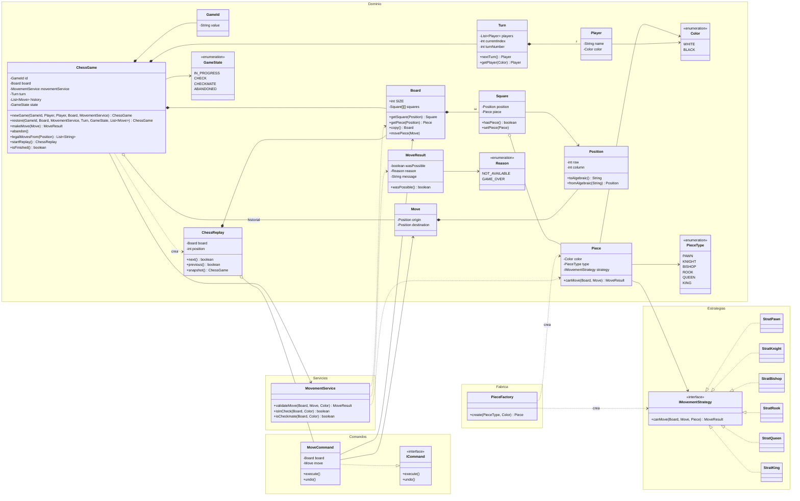
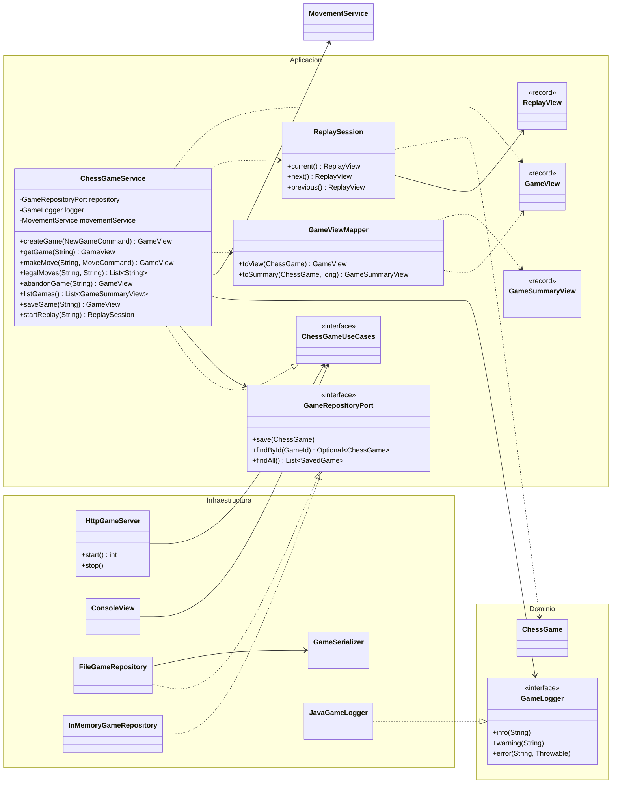

# Justificación del proyecto — Ajedrez

**Materia:** Ingeniería de Software — UADE  
**Integrantes:** Manuel Quintana Miño, Lisandro Tortora, Lautaro Ezequiel Umerez, Tomas Nahuel Medina Cotos  
**Tecnologías:** Java 17, Next.js 16, TypeScript y Tailwind CSS

## 1. Qué resuelve el proyecto

El trabajo implementa un ajedrez para dos jugadores con dos formas de usarlo:
una consola y una interfaz web. Las reglas, el turno, el jaque y el jaque mate
viven en Java; la web solo dibuja el estado que devuelve el servidor y le manda
las jugadas. Las partidas se guardan en disco, se pueden retomar desde el lobby
y se pueden reproducir cuando terminaron.

La consigna pedía separar las reglas de negocio de la interfaz y de la
persistencia. En lugar de resolverlo con capas tradicionales, donde el dominio
termina conociendo detalles de la base o del framework, elegimos arquitectura
hexagonal: el núcleo no sabe si lo están usando una consola, HTTP o un archivo.

## 2. Decisiones de diseño

### 2.1. Arquitectura hexagonal en lugar de capas tradicionales

El dominio (`ChessGame`, `Board`, `Piece`, `MovementService`) no importa nada de
infraestructura. La capa de aplicación define los puertos de entrada y salida, y
los adaptadores (consola, HTTP, archivos) se conectan desde afuera.

La alternativa era un MVC clásico con el dominio dependiendo del controlador o
del repositorio concreto. La descartamos porque cualquier cambio de interfaz
obligaba a tocar las reglas. Con puertos y adaptadores, agregar la web no cambió
una sola línea del dominio: solo se sumó `HttpGameServer` y se conectó en `App`.

**Consecuencia:** hay más interfaces y clases chicas, pero el núcleo se puede
probar sin levantar servidores ni bases de datos.

### 2.2. El dominio no conoce frameworks

No usamos Spring, JPA ni anotaciones. La inyección de dependencias se hace a
mano en `App`, que es el único lugar que conoce las implementaciones concretas.

La alternativa era Spring Boot, que resuelve el arranque y el wiring, pero mete
un contenedor y varias dependencias para un TP que no las necesita. También
íbamos a terminar explicando configuración del framework en lugar de las
decisiones de diseño del ajedrez.

**Consecuencia:** el proyecto se compila con `javac` y un script de PowerShell,
sin Maven ni Gradle.

### 2.3. Una estrategia de movimiento por pieza

Cada tipo de pieza tiene su clase (`StratPawn`, `StratKnight`, etc.) que
implementa `IMovementStrategy`. `Piece` delega en su estrategia y
`PieceFactory` arma la pieza con la estrategia correcta.

La alternativa era un `switch` gigante dentro de `MovementService` con las
reglas de las seis piezas. La descartamos porque crecía con cada regla nueva y
mezclaba validación general con el comportamiento particular de cada pieza.

**Consecuencia:** agregar una pieza o cambiar su movimiento toca una sola clase.
El costo es una indirección más al leer el código.

### 2.4. `Command` para mover y deshacer

`MoveCommand` implementa `ICommand` y guarda la pieza movida y la capturada.
`ChessGame.makeMove` valida primero y recién después ejecuta el comando. El
replay reutiliza los mismos comandos para avanzar y retroceder.

La alternativa era mutar el tablero directamente y guardar el historial en
paralelo. La descartamos porque deshacer una jugada obligaba a reconstruir el
tablero desde cero o a duplicar la lógica de captura.

**Consecuencia:** el tablero se puede modificar y revertir sin perder
información, y el replay no necesita una copia completa por jugada.

### 2.5. `MovementService` concentra jaque y jaque mate

Las estrategias validan el movimiento geométrico de la pieza, pero no saben si
el rey queda expuesto. Esa responsabilidad queda en `MovementService`, que
simula la jugada sobre una copia del tablero y verifica el jaque.

La alternativa era que cada estrategia conociera el estado completo de la
partida. La descartamos porque duplicaba la detección de jaque en seis clases y
hacía que una estrategia dependiera de las demás.

**Consecuencia:** hay una única definición de "movimiento legal" y el jaque mate
se calcula con la misma validación que usa el resto del juego.

### 2.6. Un solo contrato de lectura: `GameView`

La aplicación traduce el dominio a `GameView` con `GameViewMapper`. Ese mismo
objeto lo usan la consola y la API HTTP. Para el listado del lobby se agregó
`GameSummaryView`, una versión corta sin tablero.

La alternativa era que cada adaptador armara su propio JSON o su propio texto.
La descartamos porque el contrato se duplicaba y cualquier cambio en el tablero
obligaba a tocar dos lugares.

**Consecuencia:** el frontend tiene un único formato que entender, y el
`GameView` no expone objetos del dominio.

### 2.7. Persistencia en archivos `.properties`

`FileGameRepository` guarda cada partida en `games/<id>.properties` usando
`Properties` y `GameSerializer`. No hay base de datos.

La alternativa era SQLite o un motor embebido. La descartamos porque el TP no
necesita consultas, transacciones ni concurrencia real, y una base agregaba una
dependencia y un esquema que mantener. Los archivos se pueden abrir, revisar y
versionar sin herramientas extra.

**Consecuencia:** el guardado es simple y legible, pero no escala a muchas
partidas ni a varios procesos escribiendo a la vez. Para el alcance del TP
alcanza.

### 2.8. El `GameId` también es un nombre de archivo seguro

`GameId` valida el formato `[A-Za-z0-9_-]{1,64}`. Como el id se usa para armar
la ruta del archivo, esa validación evita path traversal sin agregar código
extra en el repositorio.

La alternativa era aceptar cualquier id y sanitizarlo al guardar. La
descartamos porque la validación en el dominio deja el repositorio más simple y
el error aparece antes, cuando se recibe el id.

**Consecuencia:** no se pueden usar ids con barras, espacios ni puntos, pero
para el uso previsto no hace falta.

### 2.9. Adaptador HTTP con el `HttpServer` del JDK

La API usa `com.sun.net.httpserver.HttpServer`, que viene con Java. No hay
Spring MVC ni un servidor embebido externo.

La alternativa era Spring Boot o un framework liviano. La descartamos por la
misma razón que en 2.2: el objetivo era mostrar el desacople, no la configuración
de un framework. El costo es escribir a mano el ruteo y el JSON, que para ocho
endpoints es manejable.

**Consecuencia:** cero dependencias y un arranque con `java -cp bin`. A cambio,
no hay validación automática de requests ni serialización declarativa.

### 2.10. El frontend no repite ninguna regla

Next.js dibuja el tablero, manda `from` y `to`, y muestra lo que responde el
backend. Los destinos legales se piden con `GET /legal-moves`; el frontend no
decide si una jugada es válida.

La alternativa era validar también en TypeScript para que la interfaz responda
más rápido. La descartamos porque dos implementaciones de las mismas reglas
terminan divergiendo, y el objetivo del TP es justamente que el dominio sea la
única fuente de verdad.

**Consecuencia:** cada selección de pieza hace una llamada al backend, pero la
interfaz nunca muestra una jugada que el servidor vaya a rechazar por reglas.

### 2.11. Polling cada 2 segundos en lugar de websockets

`useGame` consulta `GET /api/games/{id}` cada dos segundos mientras la pestaña
está visible. Alcanza para jugar en dos dispositivos y para retomar una partida
abierta en otra pestaña.

La alternativa era SSE o websockets. La descartamos porque agrega un canal
persistente, reconexión y manejo de estado que no aportan al objetivo del TP.

**Consecuencia:** hay un pequeño retraso entre lo que hace un jugador y lo que
ve el otro. Para un juego por turnos no molesta.

### 2.12. El replay es independiente de la partida guardada

`ChessReplay` arma un tablero propio desde la posición inicial y reproduce el
historial con `MoveCommand`. No modifica la partida original ni el archivo.

La alternativa era reutilizar el `ChessGame` guardado y mover su tablero hacia
adelante y atrás. La descartamos porque el replay podía dejar la partida en un
estado inconsistente si se cortaba a mitad de camino.

**Consecuencia:** se puede navegar el replay sin riesgo y la partida original
queda intacta. El costo es mantener una segunda estructura de navegación.

### 2.13. Listado tolerante a archivos rotos

`FileGameRepository.findAll` lee todos los `.properties`, ignora los que no se
pueden parsear y ordena por fecha de modificación. Un archivo corrupto no
rompe el lobby completo.

La alternativa era fallar con un error si cualquier archivo estaba mal. La
descartamos porque un archivo viejo o editado a mano dejaba al usuario sin
acceso a todas las partidas buenas.

**Consecuencia:** una partida rota desaparece del listado sin aviso. Nos pareció
mejor que bloquear todo; el error queda disponible al intentar abrirla por id.

### 2.14. Autoguardado y guardado manual

La partida se guarda sola después de cada jugada y al crearse. Además, la
pantalla de juego tiene un botón **Guardar partida** que vuelve a persistir y
confirma con un toast.

La alternativa era guardar solo cuando el usuario lo pidiera. La descartamos
porque una partida sin guardar se pierde al cerrar la pestaña, y el objetivo es
poder retomarla desde el lobby.

**Consecuencia:** hay escrituras frecuentes a disco, pero son archivos chicos y
el volumen del TP es bajo.

### 2.15. Tests ejecutables sin JUnit

Los tests son clases con `main` y aserciones de Java, ejecutadas con `-ea` desde
`build.ps1`. No hay JUnit ni un runner externo.

La alternativa era JUnit 5 con Maven o Gradle. La descartamos porque el proyecto
no usa dependencias externas y queríamos que el build se entendiera leyendo un
solo script. La deuda queda anotada: migrar a JUnit es un paso natural si el
proyecto crece.

**Consecuencia:** los tests son simples y no requieren descargar nada, pero no
hay reportes ni integración con el IDE.

## 3. Diagrama de clases

### 3.1. Dominio

**Cómo leerlo:** `*--` es composición, `o--` es agregación, `-->` es asociación,
`..>` es dependencia y `..|>` es implementación de una interfaz.

### 3.2. Aplicación e infraestructura

`ChessGameUseCases` agrupa las interfaces de entrada (`CreateGameUseCase`,
`GetGameUseCase`, `MakeMoveUseCase`, `LegalMovesUseCase`, `AbandonGameUseCase`,
`ReplayGameUseCase`, `ListGamesUseCase` y `SaveGameUseCase`) para que los
adaptadores dependan de una sola interfaz.

### 3.3. Flujo de una jugada

1. El navegador pide los destinos legales con `GET /api/games/{id}/legal-moves`.
2. `HttpGameServer` llama a `ChessGameService.legalMoves`.
3. El servicio recupera la partida con `GameRepositoryPort.findById` y llama a
   `ChessGame.legalMovesFrom`.
4. `ChessGame` prueba cada destino con `MovementService.validateMove`.
5. Cuando el jugador elige un destino, el frontend manda `POST /moves`.
6. `ChessGame.makeMove` valida, ejecuta un `MoveCommand`, actualiza el turno y
   recalcula el estado.
7. `GameViewMapper` arma el `GameView`, el repositorio guarda el archivo y el
   servidor responde el JSON que reemplaza el estado en pantalla.

## 4. Qué queda afuera

- Enroque, promoción y captura al paso.
- Tablas por repetición, 50 movimientos o material insuficiente.
- Autenticación y partidas multiusuario reales.
- Deshacer jugadas durante una partida activa (hoy solo existe en el replay).
- Migración a JUnit manteniendo el build con `build.ps1`.

Estas ausencias son decisiones de alcance, no olvidos: preferimos terminar un
ajedrez chico pero coherente, con las reglas en un solo lugar y dos interfaces
funcionando sobre el mismo dominio.
